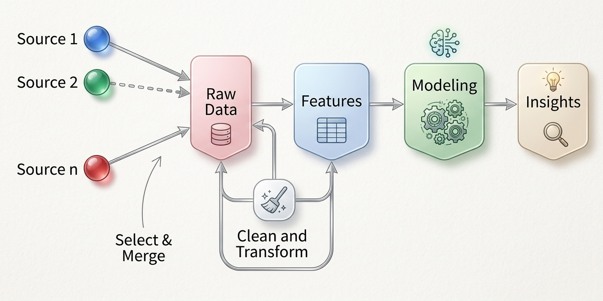

# Ingeniería de Características: Creación, Transformación y Codificación de Atributos

## Fundamentos y Propósito de la Ingeniería de Características

En el flujo de minería de datos y la Inteligencia de Negocios, los algoritmos de aprendizaje automático no operan directamente sobre conceptos abstractos de negocio, sino sobre representaciones numéricas y categóricas organizadas en tablas de datos. La **Ingeniería de Características** (*Feature Engineering*) es el proceso metodológico de transformar datos crudos en atributos estructurados que sinteticen mejor la realidad del fenómeno estudiado, aumentando la capacidad discriminativa y predictiva de los modelos.

A menudo se asume erróneamente que el rendimiento de un sistema analítico depende primordialmente de la sofisticación del algoritmo seleccionado (ej. redes neuronales profundas o modelos de ensamble). Sin embargo, la práctica profesional demuestra que **una representación rica y bien diseñada del dominio del negocio supera de forma consistente a la complejidad algorítmica** . Crear variables expresivas permite simplificar el espacio de búsqueda de los patrones, facilita la interpretabilidad de los resultados para la toma de decisiones y mitiga el problema de la alta dimensionalidad.

De este modo, la ingeniería de características actúa como el puente entre el conocimiento intuitivo del experto de dominio y el rigor matemático de la minería de datos. Al transformar variables simples en indicadores compuestos, binarizar categorías o discretizar rangos numéricos, el analista inyecta hipótesis de negocio directamente en la matriz de datos de entrada.



## Creación de Variables

La creación de atributos consiste en combinar o transformar variables existentes para construir nuevos indicadores que midan directamente la intensidad, proporción o tendencia de un fenómeno.

### 1. Ratios y Tasas Financieras o Comerciales

Las variables absolutas (como el ingreso bruto o la deuda total de un cliente) suelen estar condicionadas por la escala del sujeto de estudio. Construir **ratios y proporciones** permite estandarizar las mediciones y capturar el nivel de riesgo o eficiencia de manera comparable entre distintas observaciones:

Proporción: 

$$P_A=\frac{\#A}{N}$$

$$R_{a/b}=\frac{\#A}{\#B}=\frac{t_a}{t_b}$$

### 2. Transformaciones No Lineales y Escalamiento
Cuando las variables cuantitativas presentan distribuciones fuertemente asimétricas hacia la derecha (*right-skewed*) o diferencias extremas de escala, se deben aplicar transformaciones matemáticas para estabilizar su varianza y ajustar su comportamiento.

* **Transformación Logarítmica:** Aplica la función $y = \log(x)$ (o $y = \log(x + 1)$ si existen valores nulos) para comprimir escalas numéricas de alta dispersión (como ingresos, precios de inmuebles o poblaciones) y reducir la influencia desproporcionada de valores extremos.
* **Transformación Box-Cox:** Una familia de transformaciones de potencia parametrizada por $\lambda$ utilizada para aproximar variables continuas hacia una distribución normal multivariante:
$$y_{i}^{(\lambda )}={\begin{cases}{\dfrac {y_{i}^{\lambda }-1}{\lambda }}&{\text{if }}\lambda \neq 0,\\\ln y_{i}&{\text{if }}\lambda =0,\end{cases}}$$


* La **Estandarización Z-score** 
$$z = \frac{x - \bar{x}}{\sigma}$$
* La **Normalización Max-Min** 
$$y = \frac{x - \min(x)}{\max(x) - \min(x)}$$ 

::: {.callout-note}
### Actividad de Clase

**Escenario:** Una entidad financiera en Bolivia desea predecir la probabilidad de mora en créditos de consumo. El dataset original contiene únicamente cuatro columnas: `ingreso_mensual`, `monto_credito_solicitado`, `plazo_meses` y `cantidad_dependientes_familias`.

1. Propongan dos nuevos indicadores (ratios o combinaciones) creados a partir de las cuatro variables originales que capturen mejor la capacidad real de pago del cliente.
2. Justifiquen si aplicarían una transformación logarítmica sobre la variable `ingreso_mensual` antes de entrenar un modelo predictivo lineal y comente el impacto en la distribución.
:::

## Codificación y Tratamiento de Variables Categóricas

Las variables cualitativas o categóricas (como el estado civil, la sucursal o el tipo de contrato) requieren ser representadas en un formato numérico adecuado para que la mayoría de los algoritmos de minería de datos puedan procesarlas.

### Binarización y Variables Indicadoras (Dummy / One-Hot Encoding)
Consiste en descomponer una variable categórica nominal que posee $m$ niveles disjuntos en un conjunto de variables binarias $\{0, 1\}$.

| Categoría Original (`Sucursal`) | Dummy 1 (`sucursal_LaPaz`) | Dummy 2 (`sucursal_Cochabamba`) | Dummy 3 (`sucursal_SantaCruz`) |
| :--- | :---: | :---: | :---: |
| La Paz | 1 | 0 | 0 |
| Cochabamba | 0 | 1 | 0 |
| Santa Cruz | 0 | 0 | 1 |

Para evitar la multicolinealidad perfecta en modelos de regresión lineal o logística, se debe omitir una de las categorías para que actúe como **nivel de referencia**. De este modo, un factor con $m$ categorías genera exactamente $m - 1$ variables dummy auxiliares.

### Condensación y Agrupamiento de Alta Cardinalidad
Cuando una variable categórica posee docenas o cientos de niveles (ej. 500 códigos postales o 100 profesiones), la binarización directa expande desproporcionadamente el número de columnas del dataset, provocando el fenómeno del **aumento excesivo de dimensionalidad**.

Para solucionar la alta cardinalidad, se emplean dos estrategias principales:

1. **Agrupamiento por Frecuencia:** Fusionar categorías raras o poco frecuentes (ej. con frecuencia menor al 2% o 5% del dataset) bajo una etiqueta común denominada "Otros".
2. **Agrupamiento Experto o por Perfil:** Unir categorías que compartan un comportamiento o nivel de riesgo similar respecto a la variable objetivo (por ejemplo, agrupar profesiones según su nivel salarial promedio).


## Discretización y Binning de Variables Continuas

La **discretización** (o *binning*) es el proceso de transformar una variable cuantitativa continua en un número finito de intervalos o categorías ordenadas. Esta técnica es fundamental cuando se utilizan modelos que requieren entradas categóricas (como reglas de asociación) o para capturar relaciones no lineales complejas de forma lineal.

```
Variable Continua (Edad) ──> [Intervalos / Bins] ──> Categoría Ordinal (Joven, Adulto, Senior)
```

O también mediante:

* **Ancho Constante:** Divide el rango numérico $[\min(x), \max(x)]$ en $k$ intervalos de amplitud idéntica $w = \frac{\max(x) - \min(x)}{k}$. Es muy sensible a la presencia de outliers, ya que los valores extremos pueden dejar la mayoría de los contenedores vacíos.
* **Frecuencia Constante / Cuantiles (*Equal Frequency / Quantiles*):** Ajusta los puntos de corte (*split points*) de modo que cada uno de los $k$ intervalos contenga aproximadamente el mismo número de observaciones ($N/k$). Es una técnica robusta que preserva la densidad local de los datos.


## Variables Temporales, Secuenciales y de Contexto

Las variables asociadas a fechas y marcas temporales (*timestamps*) contienen una riqueza de información estratégica que no puede consumirse directamente como un número de serie o texto libre. La ingeniería de características para datos temporales se enfoca en tres áreas:

1. **Descomposición de Componentes de Fecha:** Extraer elementos individuales mediante: año, mes, día del mes, día de la semana, trimestre, hora del día e indicador binario de fin de semana o feriado.
2. **Variables de Rezago y Variación:** En series temporales y registros financieros, se construyen variables que comparan el valor actual $X_t$ con períodos previos $X_{t-1}$, o que miden variaciones porcentuales relativas $\Delta \% = \frac{X_t - X_{t-1}}{X_{t-1}}$.
